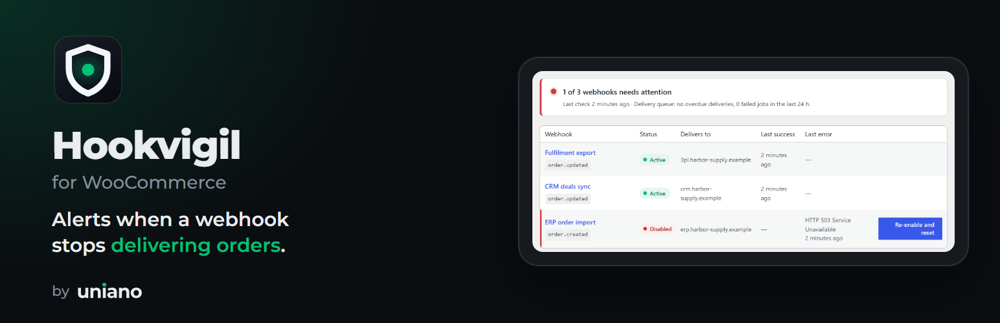
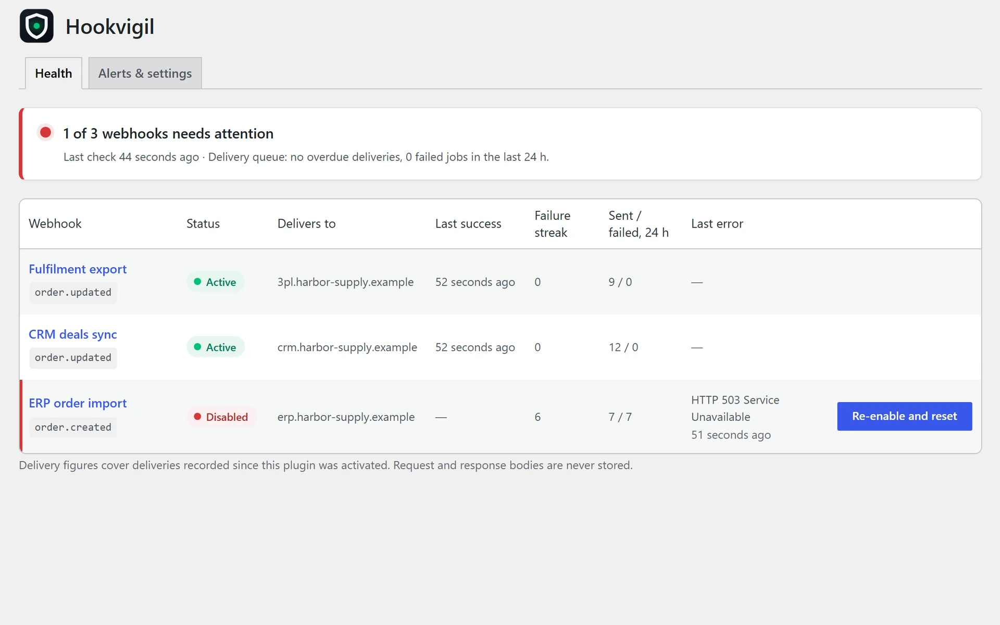
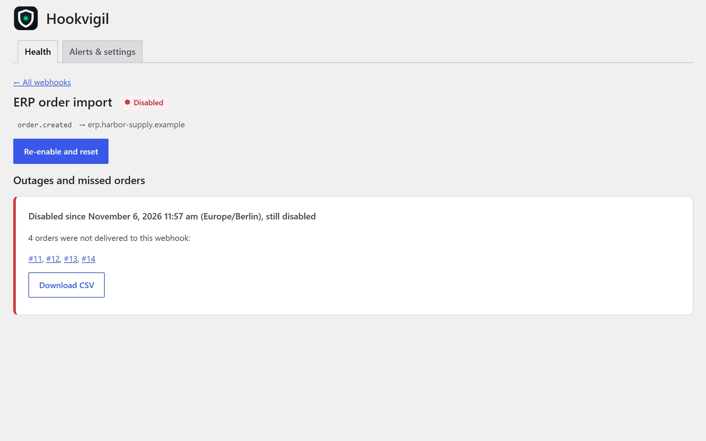
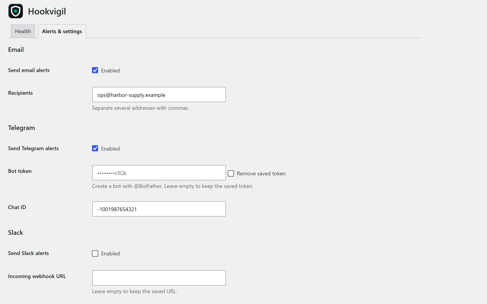
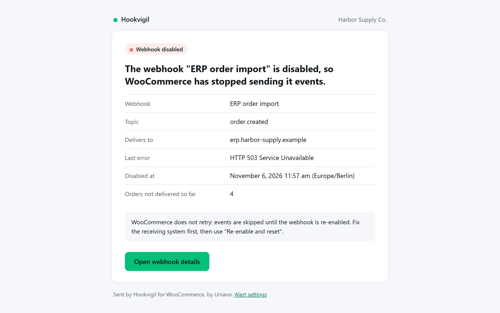

<p align="center">
  
</p>

# Hookvigil for WooCommerce

Get an email, Telegram or Slack alert when WooCommerce disables a webhook, and see which orders never reached your ERP or CRM.

WooCommerce sends orders to other systems — ERPs, CRMs, accounting, fulfilment, Zapier, Make, n8n — through webhooks. When the receiving system fails several times in a row, **WooCommerce silently disables the webhook**: no notice, no retries. Orders keep coming in but stop reaching the other system until someone notices days later. Hookvigil tells you within minutes and shows you what to fix.

## Features

- **Alert when a webhook is disabled** — email, Telegram or Slack, with the webhook, receiving host, readable last error and the orders missed so far. One alert per problem, a daily reminder while it stays broken, and a notice when it recovers.
- **Missed orders** — every order created or updated while an order webhook was disabled, with links and a CSV download.
- **Re-enable and reset** — clears the failure counter WooCommerce keeps, so one new error does not disable the webhook again.
- **Webhook health** — status, last successful delivery, failure streak, recent volume and last error for every webhook, on desktop and phone.
- **Stuck queue warning** — an alert when deliveries are overdue because the background queue stopped.

It works with the webhooks you already have. Nothing to reconfigure, no third-party monitoring service.

## Screenshots

| Webhook health | Outage and missed orders |
|---|---|
|  |  |
| **Alerts and settings** | **Email alert** |
|  |  |

## Requirements

WordPress 6.5+, WooCommerce 9.0+, PHP 7.4+. High-Performance Order Storage (HPOS) and the Cart and Checkout blocks are supported.

## Privacy

Only delivery metadata is stored (webhook ID, topic, resource ID, status or error code, duration and time), for 7 days by default. Request and response bodies are never stored. The only outgoing requests are the alerts you configure: email through your site's mail setup, the Telegram Bot API and your Slack incoming webhook. No tracking, no telemetry.

## Install

The plugin is in review for the WordPress plugin directory. Until it is listed, download `hookvigil-for-woocommerce.zip` from the [latest release](https://github.com/Uniano-Dev/hookvigil-for-woocommerce/releases/latest), then in WordPress go to **Plugins → Add New → Upload Plugin** and activate it.

## Development

The tests run WordPress and WooCommerce in [WordPress Playground](https://wordpress.org/playground/), so no local server is needed.

```bash
cd tools && npm install && cd ..
node tests/run-scenarios.mjs        # scenario tests
node tests/plugin-check.mjs         # WordPress Plugin Check
```

## License

GPLv2 or later. See [LICENSE](LICENSE).

---

Built by [Uniano Dev](https://uniano.dev) — a product and development studio.
